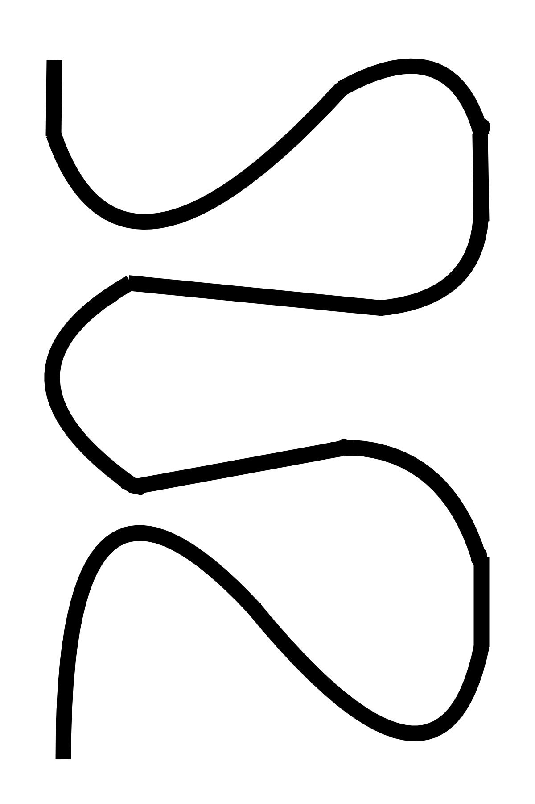

# Seguidor de Linha - Webots

**Curso:** Engenharia de Software
**Disciplina:** VCIOT
**Atividade:** Seguidor de linha

## Integrantes

- Caio dos Santos Cunha
- Letícia Akemi Sumida
- Lucas de Campos Ranzani
- Luis Gustavo Oliveira da Silva

## Descrição

Robô simulado no **Webots** que segue uma linha preta sobre uma pista branca, usando visão computacional (Python + OpenCV). A pista foi desenhada pela equipe, e possui curvas para a **esquerda** e para a **direita**.

## Estrutura do projeto

```
seguidor/
├── controllers/
│   └── car_control/
│       └── car_control.py
├── pistas/
│   └── pista.png
├── video/
│   └── demonstracao.mp4
├── worlds/
│   └── carro.wbt              
└── README.md
```
## Como executar

1. Instalar o [Webots](https://cyberbotics.com/) (Windows ou Mac).
2. Instalar as dependências do Python usadas pelo controller:
   ```
   pip install opencv-python numpy
   ```
3. No Webots, abrir o arquivo `worlds/carro.wbt` (File > Open World).
4. Verificar se o robô está com o controller `car_control` selecionado.
5. Iniciar a simulação (botão Play).

Duas janelas do OpenCV serão abertas: a imagem da câmera e a imagem binarizada da linha.

## Escolha do tipo de controle

**Decisão: controller interno do Webots, escrito em Python.**

O controle roda diretamente dentro do próprio controller do robô, e não de forma externa.

**Por que escolhemos assim:**

- **Simplicidade:** o problema (seguir uma linha) é pequeno e cabe em um único arquivo, sem necessidade de uma arquitetura mais complexa.
- **Reprodutibilidade:** basta abrir o mundo no Webots e dar Play. Não é preciso rodar um segundo programa, configurar portas ou sockets em outro computador.
- **Menos pontos de falha:** o controle externo exigiria configurar a comunicação com o simulador e poderia dar problemas diferentes em Windows e Mac.
- **Latência baixa:** a leitura da câmera e o comando dos motores acontecem no mesmo passo de simulação (`robot.step`).

O controle externo seria mais vantajoso se a lógica fosse pesada ou precisasse de outras ferramentas (por exemplo, um modelo de IA treinado), o que não é o caso aqui.

## Como funciona o algoritmo

A cada passo da simulação:

1. **Captura** a imagem da câmera e converte para tons de cinza.
2. **Recorta** a metade de baixo da imagem (região mais próxima do robô).
3. **Binariza** com `THRESH_BINARY_INV`: como a linha é preta e a pista é branca, a linha vira branco (255) e o resto preto (0).
4. **Calcula o centroide** da linha com `cv2.moments`.
5. **Calcula o erro**: diferença entre o centro da linha e o centro da imagem.
6. **Ajusta os motores** de forma proporcional ao erro (controle P):
   - `motorE = VEL + KP * erro`
   - `motorD = VEL - KP * erro`
   - Linha à direita: o robô vira para a direita. Linha à esquerda: vira para a esquerda.
7. **Fim da linha:** se nenhuma linha for detectada por alguns quadros seguidos (`FRAMES_PARAR`), o robô entende que a pista acabou e para os dois motores. O contador evita que um ruído de um único quadro faça o robô parar no meio da pista.

## Parâmetros ajustáveis

| Parâmetro | Valor | Função |
|-----------|-------|--------|
| `VEL` | 1.0 | Velocidade base dos motores |
| `KP` | 0.01 | Ganho proporcional (intensidade da curva) |
| Limiar | 80 | Valor de corte da binarização |
| `FRAMES_PARAR` | 5 | Quadros seguidos sem linha para parar o robô |

**Dicas:** se o robô balançar de um lado para o outro, diminuir `KP`. Se não conseguir fazer as curvas, aumentar `KP` ou reduzir `VEL`. Se o robô parar no meio da pista em uma curva fechada (a linha sai do campo da câmera), as mesmas correções valem.

## A pista



## Vídeo de demonstração

O vídeo está em `video/demonstracao.mp4` e mostra o funcionamento da simulação com o nome dos integrantes.

## Tecnologias

- Webots
- Python 3
- OpenCV
- NumPy